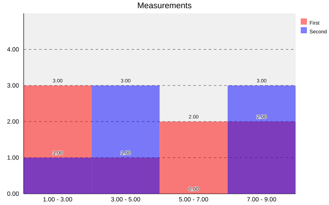

SVG::Graph
============

[](https://travis-ci.com/lumean/svg-graph2)
[](https://codeclimate.com/github/lumean/svg-graph2/maintainability)
[](https://codeclimate.com/github/lumean/svg-graph2/test_coverage)
[](https://percy.io/a5e00e98/svg-graph2)

Description
-----------
This repo is the continuation of the original [SVG::Graph library](http://www.germane-software.com/software/SVG/SVG::Graph/) by Sean Russell. I'd like to thank Claudio Bustos for giving me permissions to continue publishing the gem under it's original name: [svg-graph](https://rubygems.org/gems/svg-graph)

[Changelog](../master/History.txt)

I'm maintaing in my free time, so I can't promise on any deadlines. Please notify me (via github messages or on the Issues section) if you find any bug.

Contribute
-----
Pull requests are very welcome :-)

Usage
-----

For a complete list of configuration options please have a look at the source - most important [Graph.rb](../master/lib/SVG/Graph/Graph.rb), also checkout the subclasses (Pie, Bar, etc.) as they might provide additional options.

You can require everything at once
```ruby
require 'svggraph'
```
or only the individual parts you need
```ruby
require 'SVG/Graph/Bar'
require 'SVG/Graph/Line'
...
```

In the following some examples to get you up to speed.

### Bar
```ruby
require 'SVG/Graph/Bar'

x_axis = ['1-10', '10-30', '30-50', '50-70', 'older']

options = {
  :width             => 640,
  :height            => 300,
  :stack             => :side,  # the stack option is valid for Bar graphs only
  :fields            => x_axis,
  :graph_title       => "kg per head and year chocolate consumption",
  :show_graph_title  => true,
  :show_x_title      => true,
  :x_title           => 'Age in years',
  :show_y_title      => true,
  :y_title           => 'kg/year',
  :y_title_location  => :end,
  :no_css            => true
}

male_data   = [2, 4, 6, 4, 2]
female_data = [1, 5, 4, 5, 2.7]

g = SVG::Graph::Bar.new(options)

g.add_data( {
    :data => female_data,
    :title => "Female"
  })
g.add_data( {
    :data => male_data,
    :title => "Male"
  })

# graph.burn            # this returns a full valid xml document containing the graph
# graph.burn_svg_only   # this only returns the <svg>...</svg> node
File.open('bar.svg', 'w') {|f| f.write(g.burn_svg_only)}
```


### BarHorizontal


### Histogram

Histograms bin raw numeric samples. All series share the same boundaries; bins
include their lower bound and exclude their upper bound, except for the last
bin, which includes the maximum. Equal samples are placed in a unit-width
range centered on their value.

```ruby
require 'SVG/Graph/Histogram'
graph = SVG::Graph::Histogram.new(width: 640, height: 400, bin_count: 4)
graph.add_data(title: 'Measurements', data: [1, 2, 2, 3, 5, 6, 8, 9])
```

`bin_count` must be a positive integer; when omitted it defaults to the
ceiling of the square root of the total sample count. Histogram inherits bar
styling and the overlap and side-by-side options. Each series must contain
finite numeric values.



### ErrBar


### Line


### Pie


### Plot

Plot and TimeSeries also accept explicit point rows. Each row contains
`[x, y, description, shape, url]`; the last three entries are optional. For
TimeSeries, x can be a time string, `Time`, or integer timestamp.

```ruby
graph = SVG::Graph::Plot.new(width: 640, height: 300, add_popups: true)
graph.add_data(
  title: 'Measurements',
  points: [[2, 4, 'second'], [1, 3, 'first']]
)
```

Use either `points` or the existing `data` argument, not both. With `points`,
put descriptions, shapes and URLs in the rows rather than separate arrays.
Existing `data` inputs and subclass-facing data storage remain unchanged.

For exact plot boundaries, opt in to `strict_bounds: true` and supply any of
`min_x_value`, `max_x_value`, `min_y_value` and `max_y_value`. Unspecified
bounds use the existing automatic ranges. Points and connecting lines outside
the plot are clipped rather than expanding it; explicit bounds must define a
positive range. Tick divisions remain independently spaced, so the last tick
need not coincide with the edge. For TimeSeries, x bounds accept the same time
formats as before. Custom subclasses that override drawing without calling
`super` must implement clipping themselves.

#### Reusable point symbols

Line, Plot and TimeSeries can reuse named SVG elements for points. Built-in
symbols are `:circle`, `:square`, `:triangle`, `:diamond` and `:cross`.
Custom definitions use `[element_name, attributes]` with coordinates relative
to the point:

```ruby
graph = SVG::Graph::Plot.new(
  point_symbols: {
    square: :square,
    marker: ['path', { 'd' => 'M0 -4 L4 4 L-4 4 Z' }]
  }
)
graph.add_data(title: 'Measurements',
               points: [[1, 3, nil, 'square'], [2, 4, nil, 'marker']])
```

Definitions are emitted once in SVG `defs` and referenced by `use`. If the
selected shape (or, when absent, description) matches a configured symbol,
the symbol takes precedence over `DataPoint` shape criteria; otherwise the
existing criteria and overlays work as before. Symbols inherit the series
`dataPointN` CSS class. Subclasses that draw points themselves must opt in by
calling the protected `draw_point_shape` helper.


### Schedule


### TimeSeries


### C3js

Source: [C3js.rb](../master/examples/c3js.rb)

[Link to Preview](https://cdn.rawgit.com/lumean/svg-graph2/master/examples/c3js.html)

### Example images

The static charts in `images/` are generated from the corresponding SVGs in
`examples/`, with SVG, PNG and compressed SVG (`.svgz`) versions. For
compatibility, `bar_horizontal` is named `barhorizontal` and `err_bar` is
named `err-plot` in `images/`. PNGs are static snapshots of the SVGs.
The C3js example generates its charts in the browser and has no static image
set.

### Accessibility

For `Graph`-based charts (not C3js), provide a concise accessible name and,
optionally, a longer description:

```ruby
graph = SVG::Graph::Plot.new(
  accessible_title: 'Monthly measurements',
  accessible_description: 'Measurements increased from 3 to 4.'
)
```

These add SVG `title` and `desc` elements and an image role. A description
requires a title. This does not make the chart fully accessible: existing
popups are mouse-driven, and color, contrast, keyboard access and a suitable
text or table alternative still need to be considered by the application.

### Extending charts

`Graph` owns shared rendering and configuration, `Plot` owns numeric point
storage and scaling, and `TimeSeries` converts time values before using Plot.
Custom subclasses may override drawing and range methods and may inspect
`@data` as parallel x/y arrays; those existing extension points are retained.
`DataPoint` shape criteria are global, so configuring them affects all charts.

To display a bottom legend in rows instead of the existing vertical layout,
set `key_position: :bottom, key_layout: :horizontal`. Long entries wrap to
multiple lines, and the graph reserves space for the legend.


Build
-----
* Test

`bundle exec rake`

* Check the existing RuboCop baseline:

`bundle exec rubocop`

* Build gem:

`gem build svg-graph.gemspec`

* Install:

`gem install svg-graph-\<version>.gem`

Percy.io integration
---
https://docs.percy.io/docs/travis-ci
https://docs.percy.io/docs/snapshot-cli-command
